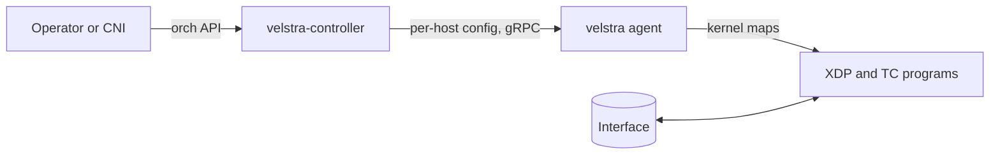

# Velstra Fabric

<picture>
  <source media="(prefers-color-scheme: dark)" srcset=".github/brand/logo-on-dark.svg">
  
</picture>

An eBPF/XDP dataplane, per-host agent, topology controller and Kubernetes CNI for tenant networks on Linux. Answer neighbor requests on the host, carry tenant Ethernet over SRv6, or apply per-port policy. For a complete firewall appliance, see [Velstra Sentinel](https://github.com/Velstra/sentinel).



## Try it

Build the controller and inspect a two-host topology. No root, virtual machines or eBPF toolchain needed.

```sh
git clone https://github.com/Velstra/fabric.git
cd fabric
cargo test -p velstra-common --locked
cargo build -p velstra-controller --locked

lab_dir=$(mktemp -d)
cp examples/topology.toml "$lab_dir/topology.toml"
./target/debug/velstra-controller serve \
  --topology "$lab_dir/topology.toml" \
  --listen 127.0.0.1:50051 --admin-listen 127.0.0.1:50052
```

In a second terminal:

```sh
./target/debug/velstra-controller orch list-ports
```

The [local fabric quickstart](https://velstra.github.io/fabric/quickstart.html) shows the expected result.

## Operator handbook

| Task | Page |
|---|---|
| Start a local fabric | [Quickstart](docs/quickstart.md) |
| Local neighbor discovery and Ethernet over SRv6 | [Overlay](docs/overlay.md) |
| Configure and run the agent | [Agent](docs/agent.md) |
| Manage topology and workload ports | [Configuration](docs/CONFIGURATION.md) |
| Deploy the Kubernetes CNI | [Kubernetes](docs/kubernetes.md) |
| Build the agent and verify the dataplane | [Development](docs/development.md), [Testing](docs/TESTING.md) |
| See how the parts fit | [Architecture](docs/ARCHITECTURE.md) |

[Browse the handbook](https://velstra.github.io/fabric/) · [Source examples](examples/) · [Release qualification](docs/RELEASE-POLICY.md)

## License

Agent/control plane: AGPL-3.0-or-later. Shared ABI/protobuf libraries:
MIT OR Apache-2.0. eBPF: GPL-2.0-or-later OR MIT.
See [LICENSING.md](LICENSING.md) for commercial terms and the component split.
