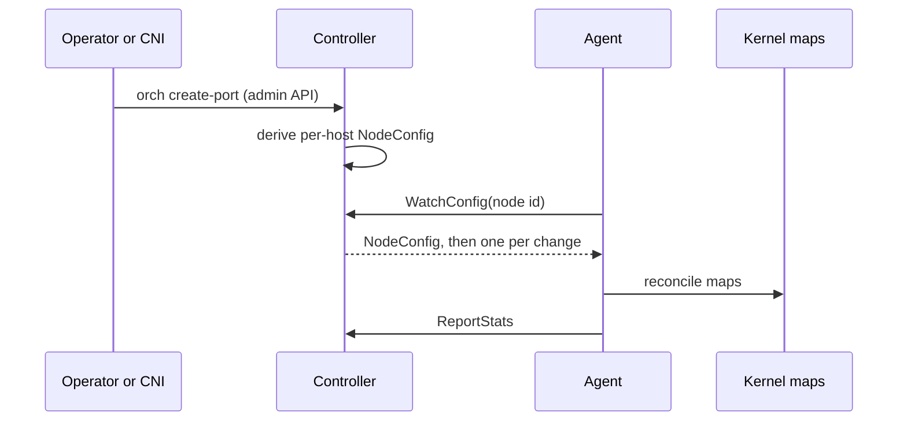
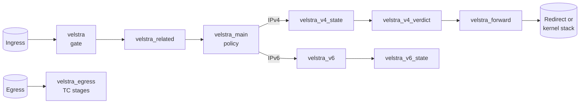

# Architecture

Follow a workload port from topology to packet handling. In the [local fabric exercise](quickstart.md), `tap-blue-1` belongs to host 1. That host's agent would receive a local interface binding; a participating remote host would receive forwarding and neighbor entries for the port.

## Crate layout

| Component | Responsibility |
|---|---|
| `velstra-orchestrator` | Models hosts, networks and ports. Allocates addresses and derives per-host configurations. |
| `velstra-controller` and `velstra-raft` | Serve configs and the management API. In cluster mode, the leader commits topology changes and followers can serve agent reads. |
| `velstra-config` and `velstra-proto` | Parse typed node configuration and define the gRPC contract. |
| `velstra-app` (binary `velstra`) | Attaches programs and reconciles kernel maps with the current node configuration. |
| `velstra-common` and `velstra-ebpf` | Share packet/map layouts, implement forwarding decisions and run the XDP/TC programs. |
| `velstra-cni` | Connects a pod interface and requests a workload port in controller mode. |

## From topology to kernel maps

The agent watches the first reachable `--controller` and identifies itself with `--node-id` (default: the hostname). The gRPC contract is [`velstra.proto`](https://github.com/Velstra/fabric/blob/main/velstra-proto/proto/velstra.proto).

## The packet path

Each box is an XDP program, chained by tail call through `VELSTRA_PROGS`; TC egress stages use `EGRESS_PROGS`. The gate drops a packet before parsing on HA ownership, configuration readiness, port identity or port rate limit.

1. The ingress interface selects a firewall policy and, for a tenant interface, a VNI. A security group can share a policy across several VNIs.
2. A tenant IP packet goes through policy and forwarding. A matching IPv4 service can translate a VIP to a backend and record the reverse mapping for replies; both directions must reach hooks sharing those maps.
3. Overlay lookups can hand a frame to a remote host. Protocol-specific shortcuts include [local ARP and Neighbor Discovery](overlay.md#local-neighbor-discovery).
4. Traffic that requires a kernel route continues through the host networking stack. IPv4 fast-path forwarding, dual-stack packet filtering and SRv6 tenant transport have different coverage.

## The map ABI

A single set of Rust key/value types defines the binary interface between agent and kernel. A packet counter measures a decision at a hook; a successful application connection exercises the path beyond it.

| Map | Holds |
|---|---|
| `IFACE_POLICY`, `CONFIG` | Interface → policy, and each policy's settings |
| `SERVICES`, `BACKENDS` | Policy-scoped service keys and their backends |
| `CONNTRACK`, `FW_FLOWS` | Connection-tracking and firewall flow records |
| `ROUTES`, `TX_PORTS` | Longest-prefix routes and redirect targets |
| `ARP_TABLE`, `ND_TABLE`, `SRV6_FDB` | VNI-scoped neighbor and overlay lookups |
| `STATS` | Per-CPU counters |

## Availability

A file-backed controller stores single-node topology in the file supplied to `--topology`. Cluster deployments use Raft; configure `--raft-dir` to keep snapshots through a full restart. Agents can contact multiple controllers and keep the last-applied policy during a controller outage. [Replicating connection state](ha-state-replication.md) between dataplanes is separate.

[Topology reference](CONFIGURATION.md) · [Verify real traffic](TESTING.md) · [Shared ABI definitions](https://github.com/Velstra/fabric/tree/main/velstra-common/src)
