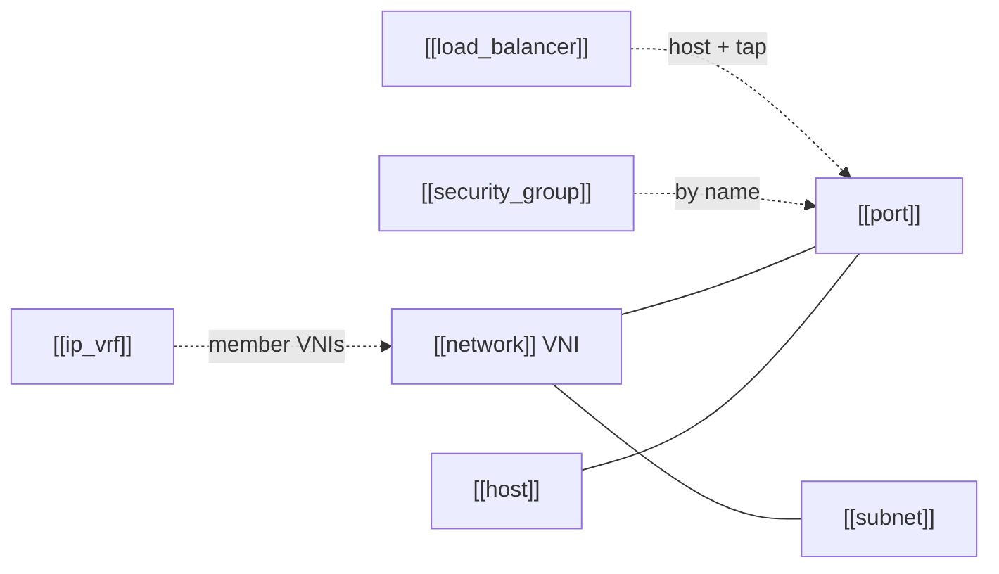

# Manage topology and APIs

The controller takes the fabric's declarations through `--topology` or the management API. The agent takes per-node policy through `--config` or receives it from a controller. Use the [worked topology](https://github.com/Velstra/fabric/blob/main/examples/topology.toml) to try both hosts and inspect their ports without running an agent.

## Topology file

A network groups tenant ports by VNI. The example below is a complete single-host topology for inspection. It names a lab interface; no agents attach when only the controller is running.

```toml
[[host]]
id = "host-1"
vtep = "10.10.0.1"
underlay_iface = "eth0"
underlay_mac = "02:00:00:00:00:11"

[[network]]
vni = 5000
name = "blue"
subnet = "192.168.100.0/24"

[[port]]
network = 5000
host = "host-1"
tap = "tap-blue-1"
ip = "192.168.100.10"
```

Save this as `topology.toml`. Start the controller as in the [quickstart](quickstart.md#start-the-example), passing this file to `--topology`. Run `velstra-controller orch list-ports` and look for `port-5000-192.168.100.10`.



| Block | What to set | Important relationship |
|---|---|---|
| `[[host]]` | Host ID, underlay interface, IPv4 VTEP and MAC | For a UDP overlay choose VXLAN or Geneve. An SRv6 locator drives service-SID derivation for a configured SRv6 host. |
| `[[network]]` | VNI, name, optional IPv4 allocation subnet and default action | On a port without a separate policy, the VNI supplies the default policy ID. |
| `[[subnet]]` | ID, VNI, CIDR and optional gateway/pool bounds | Supports IPv4 and IPv6. Gateway and bounds must lie inside the prefix. |
| `[[port]]` | Network, host, tap, optional IP and security group | Omitting the IP requests allocation; migrating a port preserves its assigned identity. |
| `[[security_group]]` | Name, default action, optional statefulness and rules | Bind by name from the port. Rules can match a source prefix as well as protocol and port. |
| `[[ip_vrf]]` | L3 VNI, anycast gateway MAC and member network VNIs | A network belongs to at most one VRF. Learned EVPN routes feed its routed context. |
| `[[load_balancer]]` | VNI, VIP, TCP/UDP port and member ports | Refer to members by host/tap in TOML and port ID in the API. The VIP and members must belong to the intended network. |

## Northbound API

The `orch` CLI uses the gRPC management service, normally at `127.0.0.1:50052`. The installed build lists its own flags:

```sh
./target/debug/velstra-controller orch --help
./target/debug/velstra-controller orch add-load-balancer --help
```

In Raft mode send topology writes to the leader. With file-backed topology, mutations update the backing file. Use a disposable copy when experimenting.

### Read the REST API

To open a local HTTP interface, add `--rest-listen 127.0.0.1:9500` to the quickstart's controller command. With that controller running:

```sh
curl --fail --silent http://127.0.0.1:9500/healthz
curl --fail --silent http://127.0.0.1:9500/v1/ports
```

The health endpoint returns `{"status":"ok"}`. The ports response describes the model currently held by the controller. The REST listener is opt-in; a loopback lab with no tokens grants local clients access.

| Resource or operation | Endpoint |
|---|---|
| Read/change topology | `/v1/hosts`, `/v1/networks`, `/v1/ports`, `/v1/subnets`, `/v1/security-groups`, `/v1/ip-vrfs` |
| Inspect public addresses or service pools | `/v1/floating-ips`, `/v1/load-balancers` |
| Read retained operations | `GET /v1/audit` |
| Subscribe to new audit entries | `GET /v1/events` (SSE) |

A slow subscriber may receive a lag notification. A consumer needing continuity should reconcile against the audit endpoint and deduplicate by sequence number. Webhook delivery retries transient failures and is best-effort. For the full set of routes and message fields, see the [HTTP router](https://github.com/Velstra/fabric/blob/main/velstra-controller/src/rest.rs) and the [gRPC contract](https://github.com/Velstra/fabric/blob/main/velstra-proto/proto/velstra.proto).

## Derived node config

See [the node configuration examples](https://github.com/Velstra/fabric/tree/main/examples) for each dataplane path. Inspect `[[interface]]` to find a local tap's policy and VNI, `[[neighbor]]` and `[[nd_neighbor]]` for the tenant IP/MAC bindings, and `[[tunnel]]` or `[[srv6_route]]` for a remote destination. A load-balanced VIP becomes a `[[service]]` under each relevant ingress policy. Direct edits to generated state are replaced on reconciliation.

## Field and command reference

| I need the complete… | Reference |
|---|---|
| Topology TOML fields, defaults and relationships | [Topology parser](https://github.com/Velstra/fabric/blob/main/velstra-controller/src/topology.rs) and [full two-network topology](https://github.com/Velstra/fabric/blob/main/examples/topology.toml) |
| Node policy, service, NAT and overlay configuration | [Typed schema and validation](https://github.com/Velstra/fabric/blob/main/velstra-config/src/config.rs) and [sample node files](https://github.com/Velstra/fabric/tree/main/examples) |
| Current management verbs and option defaults | `velstra-controller orch --help`, followed by `velstra-controller orch <verb> --help` |
| REST methods, request limits and response types | [HTTP routes and handlers](https://github.com/Velstra/fabric/blob/main/velstra-controller/src/rest.rs) |
| Protobuf request and response messages | [velstra.proto](https://github.com/Velstra/fabric/blob/main/velstra-proto/proto/velstra.proto) |

### Service pools

The local exercise includes `web-vip` with two member ports:

```toml
[[load_balancer]]
id    = "web-vip"
vni   = 5000
vip   = "192.168.100.200"
port  = 80
proto = "tcp"

[[load_balancer.member]]
host = "host-1"
tap  = "tap-blue-1"
port = 8080

[[load_balancer.member]]
host = "host-2"
tap  = "tap-blue-2"
port = 8080
```

In the TOML file, each `[[load_balancer.member]]` references a host and tap. In the CLI, members use `port-id:backend-port`. For example, `port-5000-192.168.100.10:8080` selects port 8080 on the first example VM. A port must belong to the VIP's network. A duplicate VIP/port/protocol tuple or a VIP colliding with a workload port is rejected.

Set `draining = true` on a member to stop selecting it for new flows while its established flows finish. Client affinity (`client_affinity = true`) selects by source address and can concentrate load when many clients share a NAT address. An empty pool passes traffic through and increments `lb_no_backend`.
