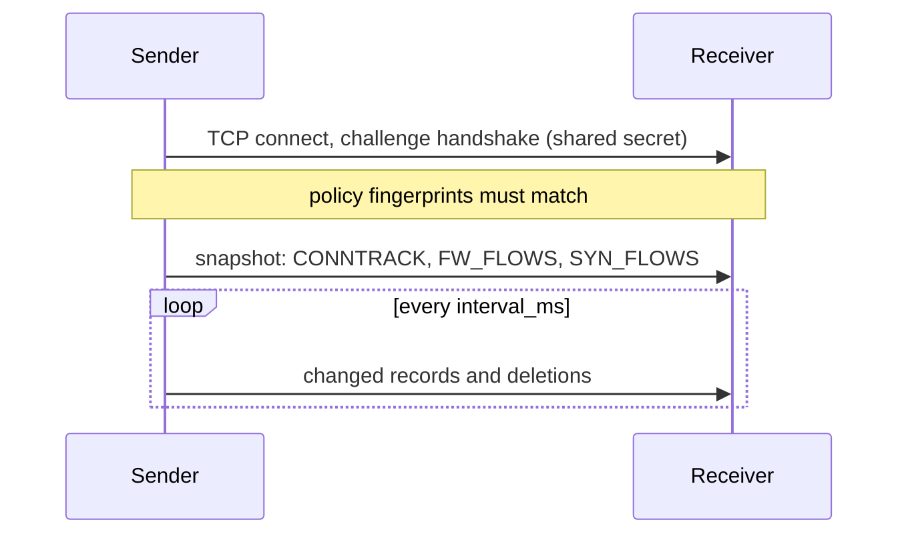

# Replicate connection state

A standby can receive NAT, firewall and SYN-proxy connection state from a peer. Configure both nodes with compatible Fabric builds and matching filtering policies. Provide a dedicated HA network or encrypted tunnel if the flow metadata needs confidentiality.

## Configure peers

Add this table to the first node's policy. Provision the same high-entropy secret (32–1024 bytes) on both nodes through your secret management, and protect the policy file.

```toml
[conntrack_sync]
listen = "192.0.2.10:5429"
peer = ["192.0.2.11:5429"]
secret = "REPLACE_WITH_A_RANDOM_SHARED_SECRET"
interval_ms = 50
```

On the second node, swap the listen and peer addresses. Replication requires authenticated TCP and explicit peers. Missing or invalid secrets and listen-only configurations are rejected; legacy unauthenticated UDP is disabled. Before upgrading both peers, configure a valid shared secret and peer addresses, or remove `[conntrack_sync]` to disable replication.

## Verify a switchover

1. Check that the peer stream establishes and both nodes accept the policy fingerprint. Filter, NAT, policy IDs, interface bindings and timeouts must agree.
2. Establish a test connection through the active node. Allow the initial snapshot and subsequent changes to reach the standby.
3. During a planned failover exercise, check progress on that **same connection**. A new client connection only demonstrates that the service is reachable again.

## How replication works



Each new session starts with a snapshot, then sends changed records and deletions. Every node sends to its peers and receives from them. Frames carry sequence numbers and an HMAC: this authenticates, it does not encrypt. Replication is asynchronous: a recent flow may still exist only on the failed node. Election, exclusive forwarding authority and ownership of a shared address must be provided separately.

[Replication implementation and tests](https://github.com/Velstra/fabric/tree/main/velstra-app/src/conntrack_sync) · [Sentinel HA verification](https://github.com/Velstra/sentinel/blob/main/nix/ha-failover-test.nix)
