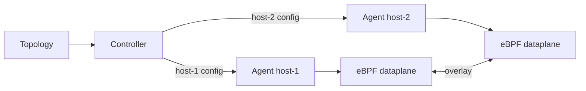

# Fabric operator handbook

Velstra Fabric connects tenant interfaces across Linux hosts. A controller turns a topology into per-host policy, neighbor entries and forwarding tables. A host agent loads those tables into the eBPF dataplane.

[Start a local fabric](quickstart.md) to inspect two hosts, two tenant networks and a load balancer. It runs entirely in userspace.

| I want to… | Start here |
|---|---|
| Keep known ARP and IPv6 neighbor lookups on the originating host | [Local neighbor discovery](overlay.md#local-neighbor-discovery) |
| Carry a tenant Ethernet frame across an IPv6 underlay | [Ethernet over SRv6](overlay.md#ethernet-over-srv6) |
| See evidence that packets traversed my policy | [Verify packet handling](TESTING.md) |
| Configure workload ports, IP allocation or a service VIP | [Topology and API reference](CONFIGURATION.md) |
| Attach a Kubernetes pod to a tenant network | [CNI deployment](kubernetes.md) |
| Review the state a standby can recover | [Connection-state replication](ha-state-replication.md) |

For a firewall appliance that includes Fabric and routing, see [Velstra Sentinel](https://github.com/Velstra/sentinel).
