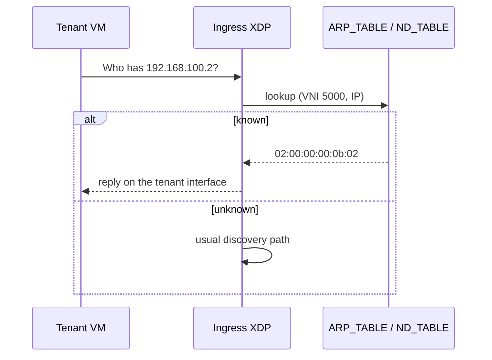
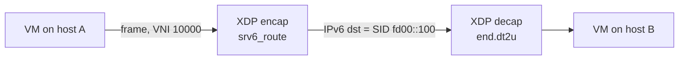

# Local neighbors and SRv6

Run these exercises from the repository root on a disposable Linux host after [building the agent](development.md#build). The test harness creates network namespaces and veth pairs, starts the agents and removes its fixtures on exit. The tests require root, XDP/TC support and iproute2.

## Local neighbor discovery

When a VM asks for the MAC of a known peer on its tenant segment, the ingress XDP program answers directly on the tenant interface. A VNI scopes the lookup, so two tenants can reuse the same IP. Unknown neighbors follow the usual discovery path.



For a node with a compatible overlay and a tenant interface bound to VNI 5000, these two records describe the remote endpoint:

```toml
[[neighbor]]
vni = 5000
ip = "192.168.100.2"
mac = "02:00:00:00:0b:02"

[[nd_neighbor]]
vni = 5000
ip = "fd00:100::2"
mac = "02:00:00:00:0b:02"
```

Install `arping` and `ndisc6` for both cases. On Debian these are supplied by `iputils-arping` and `ndisc6`. Then run:

```sh
sudo ./tests/e2e/run.sh overlay_arp overlay_nd
```

The IPv4 scenario checks both `arp_suppressed` and a reply received by the tenant. The IPv6 scenario checks `nd_suppressed` after a Neighbor Solicitation. A skipped scenario means its probe tool is missing.

## Ethernet over SRv6

Fabric can bridge tenant Ethernet frames across an IPv6 underlay. The sending host maps the tenant VNI and destination MAC to a remote service SID. With one SID, the outer IPv6 destination carries it directly. On the receiving host, an `end.dt2u` local SID identifies the tenant segment.



In the receiving host's node configuration, a local SID binding has this shape:

```toml
[[srv6_local_sid]]
sid = "fd00::100"
vni = 10000
behavior = "end.dt2u"
```

On the sending host, the corresponding `[[srv6_route]]` needs that same `remote_sid`, a tenant MAC, an underlay next-hop MAC and an output interface. Both hosts need their own `[srv6]` endpoint. The two-host fixture constructs both complete configs with the veth MACs it discovers at runtime:

```sh
sudo ./tests/e2e/run.sh srv6_roundtrip
```

Expect `srv6_encap` on host A and `srv6_decap` on host B. These assertions establish that an Ethernet frame crossed the tunnel. Check an application connection separately when evaluating workload reachability.

[Two-host fixture](https://github.com/Velstra/fabric/blob/main/tests/e2e/run.sh) · [Topology and derived state](CONFIGURATION.md#derived-node-config)
